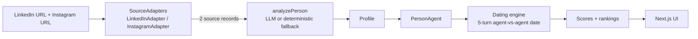

# Agentic Dating

Every person is represented by an AI agent. The agent reads **only** that person's public LinkedIn and public Instagram, builds a structured profile, dates other agents on their behalf, and produces a ranked list of best matches.

## Architecture



## Data flow
1. `collectSources` validates both URLs and returns exactly two records `{personId, sourceType, url, rawText, extractedAt}`.
2. `analyzePerson` receives only those two records (prompt forbids outside facts and sensitive inferences) and returns a Zod-validated profile.
3. `PersonAgent` wraps person + profile and exposes `analyze`, `evaluateCandidate`, `startDate`, `respondToAgent`, `scoreCompatibility`.
4. `datingEngine.runDate` runs 5 alternating turns, then `evaluatePair` scores seven dimensions.
5. `store.ranking` scores one person against everyone else and sorts.

## How LinkedIn + Instagram are used
Public pages only. `lib/scraper/public.ts` reads page title and meta descriptions with `fetch` (or Playwright if `USE_PLAYWRIGHT=1`). No login, no CAPTCHA or auth bypass, no stealth. If a platform blocks reading, the Add Person form accepts the visible public text of that same profile; demo records use a cached snapshot of the same two sources. No other source is ever used.

## Dating algorithm
Five turns (A intro, B reply, A values, B needs, A summary). Each agent identifies itself as an AI representative of its own person. With `GEMINI_API_KEY` or `OPENAI_API_KEY` each turn is LLM-written from the profile; without a key, turns use varied deterministic templates filled from the profile.

## Ranking algorithm
`score = 0.20 shared interests + 0.20 values + 0.20 lifestyle + 0.15 conversation + 0.15 complementarity + 0.10 relationship needs`, multiplied by `0.9 + 0.1 × dealbreakers/100`. Tag overlap uses Jaccard similarity plus a small seeded hash offset, so results are deterministic and calibrated between 45 and 90.

## Tech stack
Next.js 14 + TypeScript, plain CSS, Next API routes, Playwright (optional) / fetch extraction, Gemini API (`GEMINI_API_KEY`) / OpenAI API (`OPENAI_API_KEY`) via provider abstraction (`lib/ai/provider.ts`), JSON dataset + `/tmp` persistence, Zod, Framer Motion, Vercel.

## Local setup
```bash
npm install
cp .env.example .env   # optional
npm run dev            # http://localhost:3000
npm run precompute     # precomputes profiles & top dates into data/
npm run lint           # type-check
npm run build
```

## Dataset (25 Real People)
`data/people.json` contains 25 real people with public LinkedIn and public Instagram sources in `demoSourceData`. Run `npm run precompute` to refresh precalculated profile analyses (`data/profiles.json`) and top-3 date transcripts (`data/dates.json`).

## Precompute
Run `npm run precompute` to precalculate profiles and dates into `data/profiles.json` and `data/dates.json`. This ensures fast demo loads on cold starts and serverless environments (e.g. Vercel) with zero mandatory LLM API calls for preloaded seed people.

## Environment variables
- `GEMINI_API_KEY` (or `GOOGLE_GENERATIVE_AI_API_KEY` / `GOOGLE_API_KEY`)
- `GEMINI_MODEL` (default `gemini-2.5-flash`)
- `OPENAI_API_KEY` (optional)
- `OPENAI_MODEL` (default `gpt-4o-mini`)
- `USE_PLAYWRIGHT` (0/1)

## Demo mode
`/demo` works with or without an API key. Profiles load instantly from precomputed snapshots (`data/profiles.json` & `data/dates.json`) and agent dates stream smoothly.

## Limitations
- The dataset holds 25 real profile records; run `npm run ingest` to re-scrape live text or `npm run precompute` to re-cache profiles.
- LinkedIn and Instagram often block anonymous server-side reading; the app provides an optional visible public text paste fallback as well as an automatic URL slug fallback.
- Added people persist in `/tmp` (lost on redeploy) until a persistent database like Postgres is attached.
